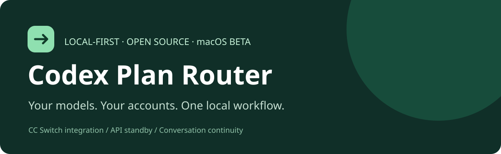

<p align="center"></p>

<p align="center"><a href="README.zh-CN.md">简体中文</a> · <a href="https://github.com/yyfmi-dot/codex-plan-router/releases">Download</a> · <a href="docs/architecture.md">Architecture</a> · <a href="docs/roadmap.md">Roadmap</a></p>

# Codex Plan Router

**Subscription-first routing, API standby, and conversation continuity for Codex.**

Codex Plan Router connects Codex to the accounts you manage in CC Switch through a local macOS companion and Codex plugin. It automatically selects eligible credentials, preserves your chosen model, and keeps conversations under one connection as you move between subscription and API access.

> **Public beta · macOS · Apple Silicon**

## Features

| Feature | What it does |
| --- | --- |
| CC Switch integration | Reuses valid Codex sign-ins and official OpenAI API providers already configured in CC Switch. Account changes sync automatically. |
| Subscription-first routing | Prefers eligible Plan credentials, tries another available Plan when needed, and uses an API key as standby. |
| Your choice of model | Inherits your current default and makes supported models available in Codex. Credential switching preserves the requested model. |
| Conversation continuity | Keeps a stable connection provider and brings existing conversations into one local history group, with backups before migration. |
| Local credential management | CC Switch manages sign-ins and refresh credentials. The authenticated local bridge provides short-lived access leases to the router. |
| Restore and recovery | Restores the previous connection and original history grouping while preserving new messages and unrelated settings. |

## Built for

- **Developers using Codex with a Plan and API standby** who want to continue working without repeatedly changing connection settings.
- **Existing CC Switch users** who want their account setup to work directly with Codex routing and model selection.
- **Teams distributing a consistent local setup** while each developer keeps authorized credentials and conversation data on their own Mac.

See [use cases](docs/use-cases.md) for deployment boundaries and supported workflows.

## Get started

### Requirements

| Component | Requirement |
| --- | --- |
| Mac | Apple Silicon, macOS 12 or later |
| Python | 3.9 or later |
| Codex | A client with Codex CLI 0.167 or later |
| Network | Access to the engine and model-catalog download sources |

The settings page currently uses Chinese. The companion is ad-hoc signed and is not Apple-notarized; first launch may require manual approval in macOS **Privacy & Security**.

### Install

1. Download the **macOS share ZIP** from [Releases](https://github.com/yyfmi-dot/codex-plan-router/releases).
2. Save your edits and quit the running CC Switch once.
3. Extract the archive and open **Install.command** or **安装.command**.
4. In local settings, review the discovered accounts, keep your current model or choose a default, and enable routing.
5. Fully quit and reopen Codex to load the model catalog. For an IDE extension, restart the editor window.

The installer places the companion in `~/Applications`, registers the Codex plugin, and opens local settings. It retains the original CC Switch application and existing account store. Keep CC Switch's Codex connection mode on **Direct**.

Use the share ZIP for the complete installation. The smaller plugin ZIP is intended for an existing companion installation.

## Everyday use

Keep the companion running and continue choosing models inside Codex. Manage accounts, API keys, and reauthentication in CC Switch. Account changes normally sync within about five seconds; the local model catalog updates periodically and can also be refreshed from settings.

API standby is billed by OpenAI. Keys in the same organization may share usage limits. Use authorized accounts within the same approved data and organizational policy boundary. Detailed connection, context, and routing limitations are documented in [use cases](docs/use-cases.md#boundaries).

### Manage and restore

From this source checkout, run:

```sh
python3 plugin/scripts/router.py status
python3 plugin/scripts/router.py settings
python3 plugin/scripts/router.py restore --history
python3 plugin/scripts/router.py stop
```

For an installed copy, use `scripts/router.py` inside the installed plugin directory. Restore the connection before stopping or uninstalling the background service. Disabling the Codex plugin alone leaves the separately installed LaunchAgent running.

Standalone credential management is available through `setup --source local`. See the [setup skill](plugin/skills/setup-router/SKILL.md) for configuration details.

## Documentation

- [Architecture](docs/architecture.md) — component responsibilities and local integration
- [Use cases](docs/use-cases.md) — workflows, account boundaries, and billing
- [Compatibility and verification](docs/verification.md) — supported evidence and release scope
- [Roadmap](docs/roadmap.md) — upcoming product work
- [Contributing](CONTRIBUTING.md) — source preparation, builds, and development
- [Security](SECURITY.md) — credential handling and reporting vulnerabilities

## License and acknowledgments

This project's code is released under the [MIT License](LICENSE). It builds on [CC Switch](https://github.com/farion1231/cc-switch), [CLIProxyAPI](https://github.com/router-for-me/CLIProxyAPI), and TOMLKit; see [third-party notices](THIRD_PARTY_NOTICES.md) for licenses and provenance.

Codex Plan Router is an independent community project, unaffiliated with OpenAI or the upstream maintainers.
