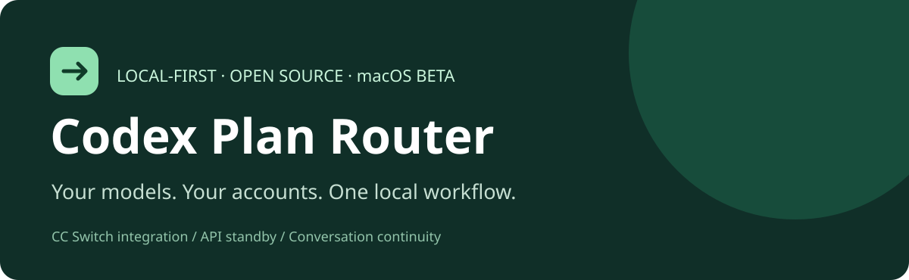

<p align="center"></p>

<p align="center"><a href="README.md">English</a> · <a href="https://github.com/yyfmi-dot/codex-plan-router/releases">下载安装</a> · <a href="docs/architecture.md">实现原理</a> · <a href="docs/use-cases.md">使用场景</a></p>

# Codex Plan Router

**模型由你选择，账号留在本机，用 API 备用通道接续 Codex 工作。**

这是一个 macOS 本机配套应用与 Codex 插件。它联动 CC Switch 的账号管理，复用 CLIProxyAPI 路由，保持同一个会话分组。项目由社区独立维护，与 OpenAI 及上游项目不存在隶属或官方背书关系。

> **公开测试版，仅 Apple Silicon / macOS 12+。** 需要 Python 3.9+、Codex CLI 0.167+。配套 App 采用 ad-hoc 签名，尚未 Apple 公证。当前设置页为中文，CC Switch 本身支持英文。团队集中管理、项目隔离、费用上限尚未实现。

## 解决什么问题

切换账号时，用户经常需要重新检查配置、找回对话列表、确认模型有没有被换掉。我们把现有能力接到一条完整的本机工作流程中：

- **CC Switch** 保存账号和 Key，刷新登录，并统一写入 Codex 连接配置。
- **CLIProxyAPI** 负责选择凭据、错误处理和额度冷却。
- **本插件** 负责安装、短期 Access Token 投影、模型目录更新，以及有备份的会话元数据迁移。

Codex 使用固定 `custom` provider，后端切换账号或 Plan/API 时保持请求中的模型名。首次启用默认沿用当前模型，之后可以在 Codex 中自己选择支持的模型。

## 当前能力

| 能力 | 行为 |
| --- | --- |
| CC Switch 联动 | 自动发现 Codex 账号与明确配置为官方 OpenAI API 地址的 Key，有效账号无需重复登录 |
| 本机路由 | 优先可用订阅凭据，再用 API，复用现有引擎的失败与冷却机制 |
| 模型选择 | 沿用默认模型或主动选择，将完整可用目录交给 Codex |
| 会话历史 | 先备份再统一 provider 元数据，活动线程遵守原生 writer lease |
| 凭据边界 | Refresh Token 留给 CC Switch 管理，插件只投影短期访问凭据 |
| 恢复 | 切回原供应商、按账本还原原官方分组，并保留新消息 |

工具不会增加服务额度或购买积分，也不保证任务永不中断。只能使用有权使用的账号，并遵守服务商条款及组织规则。API 按用量计费，同一组织的多把 Key 可能共享限额。具体边界见 [使用场景](docs/use-cases.md#boundaries)。

## 安装

1. 在 [Releases](https://github.com/yyfmi-dot/codex-plan-router/releases) 下载 macOS **share.zip** 完整包。
2. 保存编辑并退出正在运行的 CC Switch 一次。解压后双击 **安装.command** 或 **Install.command**。
3. 安装器把联动版放入 `~/Applications`，保留原 App 和账号库，通过 Codex 原生命令安装插件，并打开本机设置页。
4. 检查发现的账号，沿用当前模型或选择默认模型，点击「启用路由并统一历史」。CC Switch 的 Codex 保持 **Direct / 直连** 模式，Plan Router 卡指向单独的本机引擎。
5. 完全退出并重新打开 Codex 一次，载入模型目录。IDE 扩展需要重开编辑器窗口。

单独的插件 ZIP 不包含配套 App，首次完整联动请用 share.zip。未公证测试版首次运行可能需要本人按 macOS「隐私与安全性」提示允许；安装器不会关闭 Gatekeeper。

每位同事在自己的 Mac 安装，使用自己有权使用的账号。安装包不包含账号、Key、个人配置或聊天记录。

## 日常使用与恢复

保持配套应用运行。账号变化通常约五秒同步；失效登录需要在 CC Switch 重新认证。可在设置页更新可选模型，后台也会定期检查目录更新。

从本源码或已安装插件目录解析 `router.py` 后，可以运行：

```sh
python3 plugin/scripts/router.py status
python3 plugin/scripts/router.py settings
python3 plugin/scripts/router.py restore --history
python3 plugin/scripts/router.py stop
```

先恢复连接和历史，再停止或卸载后台服务，避免客户端仍指向已停止的地址。仅禁用 Codex 插件不会停止单独安装的 LaunchAgent。原 App、私有数据与恢复点默认保留。

不使用 CC Switch 时，可用 `setup --source local` 独立授权。该模式会拒绝与同一 Codex 目录的 CC Switch 同时写连接配置。

## 验证范围

本机原型已验证 CLI 0.167 / 0.169 的插件加载、原生模型选择列表、配置恢复及线程锁。真实 `gpt-6.2-sol` 请求完成了订阅独占首轮与显式 API 独占的同线程续接，启用时保留了模型及推理档位。

自动额度耗尽、冷却和恢复场景使用本地模拟上游验证。**尚未完成真实账号额度耗尽的端到端验收。** 跨账号的加密推理上下文可能不兼容；已有输出的请求不跨账号重放。Intel、Windows / Linux 桌面安装、Apple 公证、项目级路由策略和费用上限尚未交付。详见 [验证说明](docs/verification.md)。

## 开发与开源范围

```sh
python3 -m unittest discover -s tests -p 'test_*.py' -v
python3 scripts/prepare_companion.py
cd companion/cc-switch
pnpm install --frozen-lockfile
pnpm tauri build --features plan-router-bridge --config src-tauri/tauri.plan-router.conf.json --bundles app --ci
cd ../..
python3 build_companion.py
python3 build.py
```

配套 App 由固定版本、校验 SHA-256 的 CC Switch 源码加一份小补丁构建。完整上游工作目录、依赖、凭据和构建产物不进入本源码仓库。参见 [贡献说明](CONTRIBUTING.md)、[第三方声明](THIRD_PARTY_NOTICES.md) 和 [路线图](docs/roadmap.md)。

本项目代码使用 MIT；第三方组件保留原许可证。许可不明确的模型更新快照不随本仓库再分发，运行时仅在用户本机获取。
