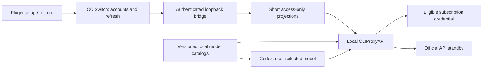

# Architecture

CC Switch is the account/refresh and native configuration owner. The existing engine is the request-routing owner. The plugin maintains disposable credential projections, local catalog generations, and a backed-up history migration ledger. No new routing engine or account-sharing backend is introduced.

## CC Switch 联动版职责与验证

## 唯一所有者

- CC Switch 的 CodexOAuthManager 管理账号、Refresh Token、代际锁、原生 Codex 凭据协调。
- CC Switch 的 ProviderService 与 codex_direct 管理 Codex 配置和供应商指针。桥接路由操作取得既有 settled lock 后调用同一 writer。
- 插件 cc_switch.py 只派生 Access Token 文件与 API Key 缓存，不存 Refresh Token；CC 列表约 5 秒轮询、失联 30 秒撤下缓存、到期前 120 秒开始续租，失效访问令牌提前 15 秒撤下。
- CLIProxyAPI 唯一决定请求选路、Plan/API 优先级及错误冷却。插件不另写选路算法。CC 默认账号优先，其余 Plan 次之，API 为负优先级。
- history.py 只负责本机历史元数据迁移和恢复账本，遵守 Codex writer lease。custom 是历史组，与 Plan/API 计费通道无关。

## 本机协议

发现文件 ~/.cc-switch/plan-router-bridge/connection.json 为 0600，父目录 0700；每次 App 启动随机端口与认证串轮换。仅监听 127.0.0.1，固定 Host，拒绝任何 Origin，无 CORS，16 KiB 请求体上限。插件不经过环境 HTTP 代理。

GET /v1/catalog 返回账号和 Key 的非秘密元数据及 Codex 目录。
POST /v1/lease/plan 通过 CC 原管理器得到同代 Token Bundle，仅枚举 Access Token、ID Token、workspace、到期时间和刷新时间返回。
POST /v1/lease/key 只允许官方 api.openai.com/v1 配置，排除回环和第三方供应商。
POST /v1/route/activate 与 /restore 委托 ProviderService。只接受本机 http://127.0.0.1:<非特权端口>/v1，拒绝不同 Codex 目录及 CC 的代理模式。其他工具已改变路由时恢复不覆盖。

CC Switch 账号删除、重认证、Key 更换会撤销或替换对应投影。未变更的文件不反复写入，避免干扰引擎冷却；跨代在飞响应丢弃。Bridge 消失不会刷新本机来源的 TTL，超过 30 秒清空派生凭据。已经发出的上游请求不被中断。

## 配套 App

上游为 CC Switch 4.0.34，MIT，原作者 Jason Young。Cargo feature plan-router-bridge 启用桥接；原版单实例机制按相同 bundle ID 互斥。保留原 App 和原账号库。联动版禁用普通版 updater，既有启动偏好为真时把已有登录项指回配套 App，不擅自开启该偏好。插件 LaunchAgent 在启动时尝试打开已安装的配套 App。

构建命令见 build_companion.py 及 src-tauri/tauri.plan-router.conf.json。当前发布 Apple Silicon App，只有 ad-hoc 签名，无 Developer ID/公证。引擎固定为 CLIProxyAPI 8.0.76，模型目录由 catalog.py 持久化上游已发布目录，配置引擎现有 models.catalog/codex-catalog 文件源；每 3 小时检查更新，失败保留上一代。内置基线与更新来源见 plugin/scripts/catalog/ORIGIN.json；首次启动立即尝试更新。CC Switch 写入指向完整模型列表的 model_catalog_json，用户可在 Codex 自选模型，默认沿用当前模型。

## 验收边界

公开验收说明见 [verification.md](verification.md)，本机私有报告不随源码分发。Python 生命周期/历史测试、原生 Rust HTTP 桥接/配置往返及登录策略测试、真实 supervisor 与引擎联动、原生 Codex 插件加载和 writer lease、模拟额度耗尽调度分开记录。live_cc_probe.py 为显式启用的两次真实推理，可验证 Plan 到 API 同线程上下文；它不修改当前用户的模型路由，也不代表真实额度耗尽验收。

同模型启用路由时，ProviderService 在既有切换锁内按 Codex writer 的 ROW_TOP_FIELDS、CODEX_EXCLUSIVE_TOP、CODEX_FLOOR_NESTED 保留当前模型偏好，包括推理档位和上下文设置。
